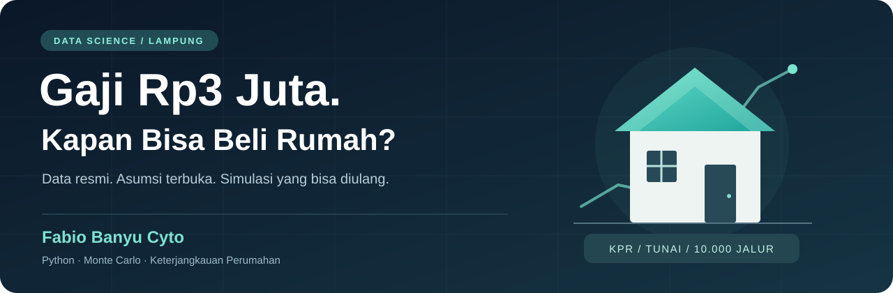
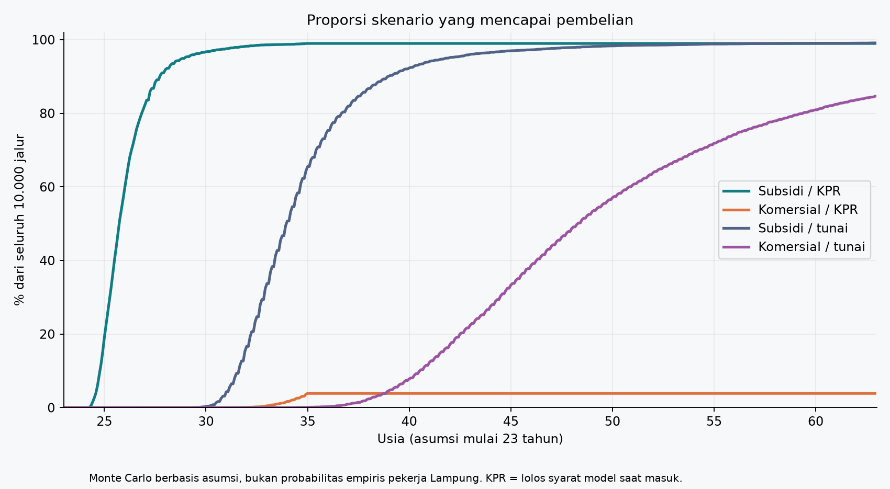
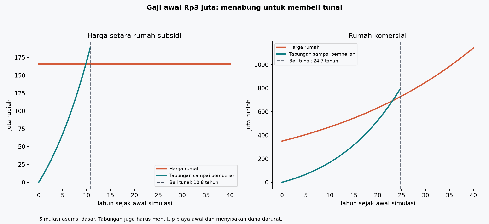
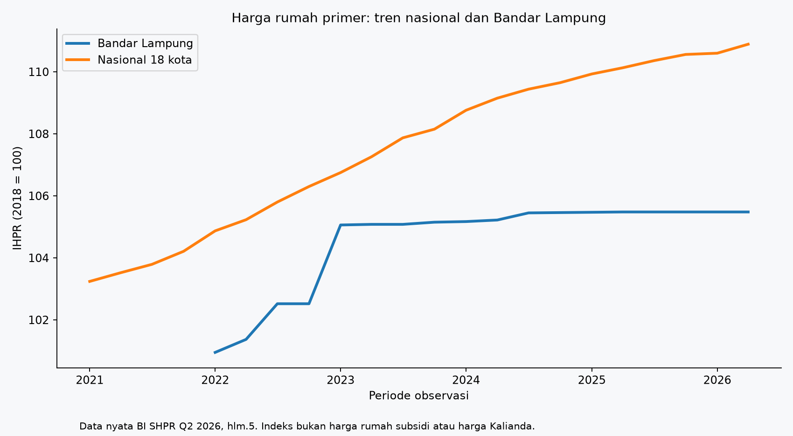
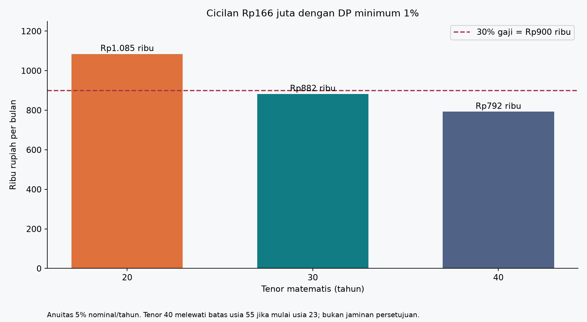

<div align="center">



# Gaji Rp3 Juta, Kapan Bisa Beli Rumah?

**Studi keterjangkauan rumah di Lampung oleh [Fabio Banyu Cyto](https://github.com/fabiobanyu)**


[](https://github.com/fabiobanyu/gaji-3-juta-kapan-beli-rumah/actions/workflows/validate.yml)

[Buka notebook](analisis_lampung.ipynb) · [Baca laporan](reports/laporan.md) · [Lihat hasil](results/summary.csv) · [Audit sumber](data/source_manifest.csv)

</div>

## Pertanyaan yang dekat dengan kehidupan sehari-hari

Gaji Rp3 juta, biaya hidup tetap berjalan, dan harga rumah terus menjadi pertanyaan besar. Berapa lama menabung untuk membeli tunai? Apakah DP yang terkumpul berarti cicilan sudah terjangkau? Seberapa jauh hasilnya berubah jika gaji, biaya hidup, harga rumah, dan bunga bergerak berbeda?

Proyek ini menggabungkan **data resmi BPS, Bank Indonesia, dan SiKumbang/BP Tapera** dengan model arus kas bulanan serta simulasi Monte Carlo. Data observasi, ketentuan program, asumsi, dan hasil simulasi disimpan terpisah agar pembaca bisa menelusuri setiap angka.

> **Hasil utama:** pada satu skenario dasar, syarat finansial KPR rumah Rp166 juta tercapai setelah **2 tahun 9 bulan**. Angka ini memerlukan kenaikan gaji, DP tambahan, dan asumsi harga subsidi tetap; bukan janji persetujuan bank.

## Sekilas hasil

Profil contoh: usia awal **23 tahun**, gaji bersih awal **Rp3 juta/bulan**, biaya hidup awal **Rp2,1 juta/bulan**, dan tabungan awal **Rp0**.

| Alternatif | Waktu dalam skenario dasar | Hal yang perlu dibaca bersama |
|:--|--:|:--|
| KPR rumah subsidi, anuitas 20 tahun | **2 tahun 9 bulan** | DP aktual sekitar Rp15,05 juta; cicilan awal sekitar Rp996 ribu/bulan |
| Tunai rumah dengan harga setara subsidi | **10 tahun 9 bulan** | Harga Rp166 juta diasumsikan tetap |
| Tunai rumah komersial | **24 tahun 8 bulan** | Harga awal Rp350 juta tumbuh 3% per tahun |
| KPR rumah komersial, tenor 20 tahun | **Tidak tercapai** dengan batas usia lunas 55 | Jika batas usia skenario menjadi 65, waktu masuk sekitar 19 tahun 10 bulan |

Asumsi dasar: gaji naik **4%/tahun**, biaya hidup **3%/tahun**, imbal hasil tabungan neto **3%/tahun**, dana darurat **6 bulan**, biaya awal **3% subsidi / 5% komersial**, dan tidak ada utang lain. Angka ini adalah parameter analisis, bukan statistik pertumbuhan pribadi dari BPS.



**96,71%** jalur KPR subsidi mencapai syarat masuk hingga usia 30. Namun, sekitar **32,01% dari jalur yang masuk kemudian melanggar batas anggaran** setidaknya sekali. Peluang tersebut berlaku untuk distribusi asumsi model, bukan peluang seluruh pekerja Lampung atau persetujuan bank.

<details>
<summary><strong>Mengapa “5% bunga” perlu diperiksa?</strong></summary>

Halaman FLPP yang tersimpan menggunakan kata **flat**. Kasus utama menghitung **anuitas dengan bunga nominal tahunan 5%**, sehingga metode flat juga diuji secara terpisah. Hasil deterministik berubah dari **2 tahun 9 bulan menjadi 4 tahun 5 bulan**. Keduanya tersedia di [tabel sensitivitas](results/sensitivity.csv). Tenor hingga 40 tahun pada halaman terbaru juga dibedakan dari brosur lama yang menyebut 20 tahun.

</details>

## Data apa yang benar-benar ada?

| Sumber | Data yang disimpan | Peran dalam riset |
|:--|:--|:--|
| BPS | Upah provinsi/sektor 2025; pengeluaran Susenas Lampung Maret 2025; riwayat pengeluaran; tabel inflasi; PDF Lampung Dalam Angka 2026 | Konteks ekonomi dan pemeriksaan data agregat |
| Bank Indonesia | SHPR Q2 2026; IHPR nasional dan Bandar Lampung; referensi bunga agregat | Tren historis dan backtest pembanding |
| SiKumbang | Dua tipe unik di Menara Siger Residence, Kalianda: Rp166 juta dan Rp350 juta | Harga penawaran awal untuk dua skenario |
| BP Tapera / bank penyalur | Halaman program, brosur, DP/bunga/tenor, contoh batas usia | Referensi ketentuan dan sensitivitas pembiayaan |

**Harga listing bukan harga transaksi atau rata-rata pasar.** Pengeluaran per kapita BPS bukan anggaran hidup otomatis seorang pekerja lajang. Bandar Lampung juga berbeda dengan lokasi proyek di Kalianda.

Semua unduhan dicatat dengan URL, waktu akses, ukuran, dan SHA256. Tabel yang gagal dimuat tidak diklaim berhasil menjadi dataset. Ketidaksesuaian total pengeluaran antar tabel PDF BPS dipertahankan dan ditandai, lalu dikeluarkan dari kalibrasi. Lihat [kamus data](docs/DATA_DICTIONARY.md), [manifest sumber](data/source_manifest.json), dan [catatan kualitas](results/data_quality.csv).

## Bagaimana model bekerja?

```text
Data resmi & snapshot sumber
            ↓
Pembersihan + audit metadata
            ↓
Profil anggaran & parameter asumsi
            ↓
Arus kas bulanan selama 40 tahun
            ↓
Tunai / KPR subsidi / KPR komersial
            ↓
Simulasi deterministik + 10.000 jalur Monte Carlo
            ↓
Sensitivitas, risiko anggaran, grafik, dan laporan
```

Model memeriksa biaya awal, dana darurat, DP tambahan, batas cicilan 30% gaji, sisa arus kas 10%, biaya perawatan, penghapusan sewa setelah membeli, dan contoh pembatas usia saat kredit lunas. KPR komersial menggunakan tiga tahun bunga tetap, lalu penyesuaian tahunan. Keempat alternatif adalah skenario pembanding terpisah.

**Mampu menyiapkan dana awal, memenuhi syarat finansial masuk KPR, dan melunasi rumah adalah tiga hasil berbeda.** Model menilai keberlanjutan arus kas sesudah masuk KPR; pembelian tunai hanya dinilai sampai saat pembelian.

## Jalankan sendiri

```bash
git clone https://github.com/fabiobanyu/gaji-3-juta-kapan-beli-rumah.git
cd gaji-3-juta-kapan-beli-rumah
python -m pip install -r requirements.txt
python scripts/verify_research.py
python model.py
```

Untuk menjelajah langkah demi langkah, buka **[analisis_lampung.ipynb](analisis_lampung.ipynb)** di Jupyter atau VS Code. Notebook sudah menyimpan tabel dan grafik. Jalankan dari folder repository; data lokal sudah disertakan sehingga analisis tidak memerlukan pengunduhan ulang.

```bash
python -m pip install jupyterlab
python -m jupyterlab analisis_lampung.ipynb
```

Ubah parameter `BASE` di notebook atau `model.py`, kemudian jalankan ulang analisis. `assumptions.json` merekam parameter saat hasil dibuat; berkas itu belum menjadi berkas konfigurasi yang dibaca otomatis. Seed dasar: **20261030**. [Lingkungan yang digunakan](docs/environment.json) menyimpan versi paket saat penelitian dijalankan.

## Isi repository

```text
├── analisis_lampung.ipynb     # Notebook dengan hasil tersimpan
├── model.py                  # Simulasi, sensitivitas, backtest, validasi
├── assumptions.json          # Catatan asumsi yang digunakan
├── data/
│   ├── raw/                  # Snapshot resmi, PDF, dan ekstraksi
│   ├── processed/            # Dataset terstruktur CSV
│   └── source_manifest.*     # Provenance dan status unduhan
├── figures/                  # Empat visualisasi penelitian
├── results/                  # Hasil deterministik, Monte Carlo, audit
├── reports/                  # Laporan Markdown dan HTML mandiri
├── docs/                     # Kamus data dan panduan reproduksi
├── scripts/                  # Pengumpulan, pengolahan, pemeriksaan
└── assets/                   # Banner proyek
```

<details>
<summary><strong>Lihat perbandingan tabungan dan harga rumah</strong></summary>



</details>

<details>
<summary><strong>Lihat tren historis dan sensitivitas cicilan</strong></summary>





</details>

## Validasi dan batas interpretasi

Snapshot penelitian melewati **16 pemeriksaan perhitungan**. Backtest indeks BI memakai expanding window, bukan pembagian data acak. Proses CI memeriksa kembali sumber, integritas hasil, dan perhitungan dasar; status aktual terlihat pada tab Actions.

Monte Carlo **belum dikalibrasi sebagai probabilitas empiris**. Model mengasumsikan pekerjaan berkelanjutan dan belum memasukkan PHK, penambahan tanggungan, renovasi besar, perubahan aturan, atau skor kredit personal. Riwayat indeks yang pendek tidak digunakan untuk mengklaim ramalan harga unit selama 40 tahun. Keterbatasan lengkap tersedia di [laporan](reports/laporan.md).

## Tentang penulis

**Fabio Banyu Cyto** — [@fabiobanyu](https://github.com/fabiobanyu)

Proyek portofolio data science yang menghubungkan analisis data, simulasi stokastik, dan pertanyaan keterjangkauan rumah. Kontribusi berupa koreksi sumber, perbaikan metode, atau tambahan data yang bisa diverifikasi sangat terbuka. Baca [panduan kontribusi](CONTRIBUTING.md).

**Sumber eksternal:** [BPS Lampung](https://lampung.bps.go.id/), [Bank Indonesia](https://www.bi.go.id/), [SiKumbang](https://sikumbang.tapera.go.id/), dan [BP Tapera](https://www.tapera.go.id/). Atribusi penulis proyek tidak mengubah kepemilikan sumber pihak ketiga; repository tidak mengklaim afiliasi resmi dengan lembaga tersebut.
